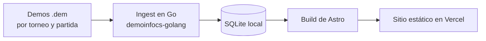

## TL;DR

**[9z Hub](https://9zhub.com.ar/)** es un sitio fan, sin fines de lucro, con estadísticas históricas de los jugadores de **9z** en Counter-Strike 2. No usa ninguna API oficial: todos los números salen de **parsear los archivos de demo** de las partidas con un pipeline propio en Go, que guarda todo en SQLite. Después, Astro genera un sitio 100% estático que se sirve desde Vercel.

---

## La idea: estadísticas que no existen en otro lado

Las páginas de estadísticas de esports muestran lo de siempre: K/D, rating, mapas. Yo quería responder preguntas más de hincha:

- ¿A qué rival **le hicieron más bajas** los jugadores de 9z? (los famosos "burritos")
- ¿Con qué compañero se **tradean** más?
- ¿Cuál es su **mejor mapa** y cuántos clutches ganó cada uno?
- ¿Cómo le fue a 9z contra cada rival, serie por serie?

Para eso no alcanza con datos agregados: hay que ir a la fuente, las **demos**, que registran cada evento de la partida.

---

## Arquitectura: procesar en local, servir estático

La decisión más importante fue **separar el procesamiento del sitio**:

- Las demos pesan mucho y la base crece rápido, así que **nunca suben a Vercel**.
- El ingest y el build corren en mi computadora.
- Vercel solo sirve el directorio `dist/` ya generado: HTML estático, rápido y gratis de hostear.

### El pipeline de ingest en Go

Usé la librería **demoinfocs-golang**, que parsea las demos de CS2 y emite eventos (rondas, bajas, disparos, granadas, bomba). Sobre eso armé una herramienta de línea de comandos que:

- recorre el dataset con estructura `torneo/partida/mapa.dem`;
- calcula hashes para **detectar demos duplicadas**;
- normaliza jugadores a una identidad canónica (los nicks cambian, las personas no);
- guarda rondas, bajas, resultados por mapa y muestras de posición de los jugadores;
- permite procesar **de a poco** (`--limit 1`, `--limit 25`) o agregar a una base existente sin rehacer todo.

También tiene un modo para **inspeccionar una sola demo** sin escribir en la base, que me ayudó muchísimo a entender qué datos trae cada archivo.

> [!tip] Datos livianos primero
> Guardar la posición de cada jugador en cada tick haría explotar la base. Por eso el ingest toma **una muestra cada 64 ticks** y prioriza eventos puntuales. Las visualizaciones 2D de mapas se pueden construir después sobre esas muestras.

### El sitio en Astro

Astro lee la base SQLite en el build y genera todas las páginas:

- **Inicio:** panel estilo gamer con el roster, métricas del jugador destacado, burritos y partidas recientes.
- **Burritos:** tabla de rivales más abatidos por cada jugador.
- **Rivales:** series jugadas, victorias, derrotas y win rate contra cada equipo.
- **Demos:** el listado completo y el detalle de cada partida, con scoreboard y rondas.

Además genera **imágenes Open Graph** por partida y un sitemap, para que cada demo se pueda compartir con buena preview.

---

## Stack

| Parte | Tecnología |
| --- | --- |
| Parser | Go con demoinfocs-golang |
| Datos | SQLite (better-sqlite3 en el build) |
| Sitio | Astro estático, generación de OG con sharp |
| Hosting | Vercel con Analytics y Speed Insights |

---

## Lo que aprendí

- **Usá el lenguaje correcto para cada parte.** Go para parsear archivos binarios grandes, Astro para un sitio rápido. No todo tiene que estar en JavaScript.
- **Estático es imbatible** cuando los datos cambian una vez por torneo: costo cero y velocidad máxima.
- **Las identidades son un problema de datos.** Normalizar jugadores fue más difícil que parsear las demos.
- **Los proyectos de fan son el mejor laboratorio.** Sin presión comercial, podés experimentar con diseño y datos a gusto.

9z Hub está online en [9zhub.com.ar](https://9zhub.com.ar/). Es un proyecto sin fines de lucro y no está afiliado a 9z.
