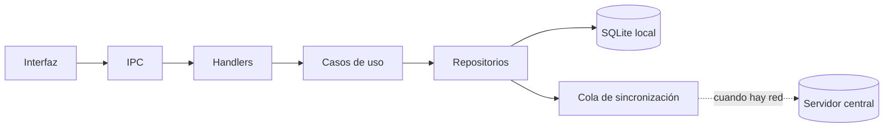

## TL;DR

En **G2M Technology Group** desarrollamos una **aplicación de escritorio para trazabilidad logística** que se usa en estaciones de trabajo de operación. Su regla de oro es simple: **el operario nunca ve un error de conexión**. La app trabaja contra una base **SQLite local** y sincroniza con el servidor central cuando hay red.

> [!note] Sobre este post
> Es un producto de mi trabajo actual. Cuento la arquitectura y las decisiones técnicas generales, sin flujos de negocio, datos ni detalles de clientes.

---

## El problema: la red falla justo cuando más se la necesita

En un entorno de operación, las conexiones se cortan, los servidores se reinician y el Wi-Fi no llega a todos los rincones. Si cada escaneo depende de una llamada al servidor:

- la operación se frena ante cualquier corte;
- los usuarios aprenden a "esperar a que vuelva", y se pierden registros;
- un problema de infraestructura se convierte en un problema de negocio.

---

## La solución: local primero, sincronizar después

- **SQLite es la fuente de verdad local.** Toda operación se guarda primero en la máquina.
- **Cada cambio se encola** para replicarse de forma asíncrona al servidor central.
- Si no hay red, la app **sigue funcionando** igual. Cuando la conexión vuelve, la cola se vacía sola.

---

## Arquitectura hexagonal dentro de Electron

Electron mezcla fácilmente interfaz y lógica. Para evitarlo, la app se organiza en **capas concéntricas** con una regla de dependencia estricta:

1. **Renderer:** la interfaz, en HTML, CSS y JavaScript sin frameworks.
2. **IPC:** el único puente entre la interfaz y el proceso principal.
3. **Handlers:** reciben pedidos y los traducen a casos de uso.
4. **Casos de uso:** orquestan la lógica.
5. **Repositorios:** acceden a SQLite o al servidor remoto.

Las capas externas conocen a las internas, **nunca al revés**. Eso permite testear la lógica sin abrir una ventana y cambiar la persistencia sin tocar la interfaz.

> [!tip] Estaciones como configuración
> La app tiene distintas "estaciones" según el puesto de trabajo, y un motor de flujo define qué pasos corresponden a cada una. Sumar una estación nueva es, en buena parte, configuración.

---

## Performance como requisito, no como deseo

En una estación donde se escanea todo el día, cada milisegundo cuenta. Por eso el proyecto incluye:

- **benchmarks automatizados** con Vitest sobre las operaciones críticas;
- **presupuestos de regresión** por percentil 95: si una operación se vuelve más lenta que el límite, los tests fallan;
- pruebas manuales documentadas para escenarios difíciles de automatizar.

---

## Calidad y distribución

- Tests **unitarios, de integración y end-to-end** con Playwright sobre la app de escritorio.
- **Una sola instancia por PC** en producción; varias en desarrollo y QA.
- Instalador para Windows, y un **modo QA** que permite cambiar de estación sin reiniciar.
- Documentación técnica de arquitectura, auditoría y benchmarks.

---

## Stack

| Parte | Tecnología |
| --- | --- |
| Escritorio | Electron |
| Interfaz | HTML, CSS y JavaScript sin frameworks |
| Datos locales | SQLite con better-sqlite3 |
| Sincronización | Cola propia hacia el servidor central |
| Calidad | Vitest, Playwright y benchmarks con presupuestos de p95 |

---

## Lo que aprendí

- **Offline-first cambia toda la arquitectura,** y conviene decidirlo el primer día.
- **Una regla de dependencia simple** (afuera conoce adentro, nunca al revés) mantiene ordenado incluso un proyecto Electron grande.
- **Medir la performance en CI** evita que la app se vuelva lenta de a poco sin que nadie lo note.
