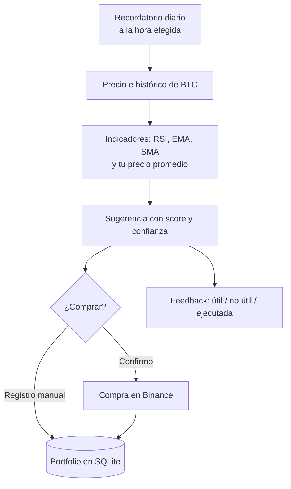

## TL;DR

Este proyecto es un **bot de Telegram escrito en Rust** que me ayuda a sostener una estrategia de ahorro en Bitcoin sin depender de la emoción del momento. Todos los días calcula una sugerencia a partir de indicadores técnicos, me la manda a la hora que elegí, registra mis compras y, si lo autorizo explícitamente, ejecuta la compra en Binance.

> [!warning] Aclaración importante
> Es una herramienta de **disciplina personal**, no asesoramiento financiero. Cualquier compra requiere confirmación explícita.

---

## El problema: comprar con la cabeza y no con el miedo

La estrategia de comprar de a poco y con regularidad es simple en teoría. En la práctica:

- cuando el precio sube, dan ganas de comprar todo;
- cuando baja, da miedo y no comprás nada;
- y si no anotás tus compras, no sabés cuál es tu precio promedio real.

Quería algo que me recordara todos los días, me diera contexto objetivo y llevara las cuentas por mí. Telegram fue la interfaz obvia: ya lo tengo abierto todo el día.

---

## Cómo funciona

### Datos de mercado con fallback

El bot no depende de un único proveedor. Consulta el precio en orden y pasa al siguiente si uno falla:

1. Coinbase
2. Kraken
3. Binance
4. CoinGecko

Ninguno necesita API key para el uso básico.

### Indicadores clásicos

Calcula indicadores técnicos conocidos (RSI, medias móviles exponencial y simple) y los compara con **mi propio precio promedio de compra**. Con eso arma una sugerencia con un puntaje y un nivel de confianza, y la muestra en dos vistas: una **simple**, tipo tarjeta, y una **pro**, con el detalle técnico.

### Gráficos generados en el servidor

Con la librería **plotters** el bot dibuja gráficos de precio y del portfolio como imágenes, y los manda directo al chat. Sin servicios externos de gráficos.

---

## Lo que se puede hacer desde el chat

- Ver la sugerencia del día, el precio actual y el detalle técnico.
- Registrar, editar y borrar compras, y ver el portfolio.
- Definir un presupuesto mensual.
- Elegir unidad (BTC o satoshis) y vista (simple o pro).
- Configurar el horario del recordatorio diario.
- Exportar o **borrar todos mis datos** con un comando.

Cada chat tiene su propio portfolio, presupuesto y configuración, y un administrador habilita o deshabilita usuarios.

---

## Seguridad: el punto más delicado

Conectar un bot a un exchange exige cuidado. Algunas decisiones:

- **Las credenciales se guardan cifradas** en SQLite con una clave maestra que vive solo en el servidor (cifrado con la librería `ring`).
- El bot **intenta borrar el mensaje** donde pegaste las credenciales apenas lo recibe, y en los logs guarda eventos redactados.
- La guía de uso recomienda claves de API **sin permiso de retiro** y con restricción por IP.
- Ninguna compra se ejecuta sin una **confirmación explícita** por botón.

---

## Stack

| Parte | Tecnología |
| --- | --- |
| Lenguaje | Rust con tokio |
| Telegram | teloxide en modo polling |
| Datos | SQLite con rusqlite |
| HTTP | reqwest con rustls |
| Gráficos | plotters |
| Cifrado | ring |
| Deploy | Binario compilado corriendo como servicio de systemd |

---

## Lo que aprendí

- **Rust para bots es una gran elección:** un binario chico, sin runtime, que consume poquísima memoria y corre meses sin reiniciarse.
- **Tener varios proveedores es obligatorio** cuando dependés de APIs públicas gratuitas.
- **El feedback dentro del flujo** (útil / no útil / ejecutada) me dio datos reales para mejorar las sugerencias.
- **La seguridad no se agrega después,** sobre todo cuando hay plata de por medio.
