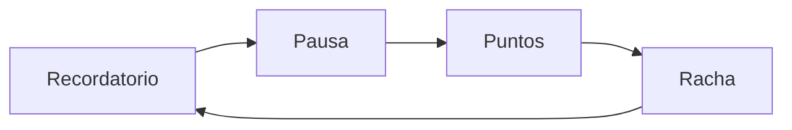

## TL;DR

**CoBreak** es "coworking, pero para descansar". Es una app móvil que te avisa cuando toca cortar, te propone una pausa corta y activa (estirar, descansar la vista, respirar) y registra tu progreso con puntos y rachas para que tengas un motivo para volver.

El proyecto es un monorepo con una **app Android nativa en Kotlin** y una **landing en Astro**, con un pipeline que publica cada versión automáticamente en Google Play.


---

## El problema: todos sabemos que hay que cortar, nadie corta

Si trabajás frente a una pantalla, ya sabés que deberías levantarte cada tanto. El problema no es la información, es el **hábito**:

- Las pausas se posponen "cinco minutos más" hasta que se olvidan.
- Los timers de productividad tratan el descanso como un trámite.
- Las apps de fitness piden demasiado para una pausa de oficina.

CoBreak apuesta a algo más simple: **pausas accesibles que puedas hacer en cualquier lugar**, sin equipamiento y sin sentir que estás "entrenando".

---

## El ciclo central

Todo el producto gira alrededor de un loop corto y fácil de entender:



1. Configurás tu rutina de pausas.
2. CoBreak te manda una notificación.
3. Aceptás, posponés o salteás la pausa.
4. Hacés una actividad corta guiada.
5. Sumás puntos y mantenés tu racha.

> [!tip] Una decisión de producto que me gusta
> Lo social existe, pero **sin chat libre**: círculos, metas compartidas, reacciones y desafíos cooperativos. El chat trae moderación, spam y abuso; para pausas de 20 segundos no hace falta.

---

## La parte técnica más interesante: un motor de rutinas que no depende de la UI

En Android, que una notificación llegue **a horario** es más difícil de lo que parece: el sistema mata procesos, el teléfono se reinicia, el modo ahorro de batería posterga alarmas. Por eso el corazón de la app es un **motor de rutinas** independiente de la interfaz y de Android.

El flujo de ejecución es siempre el mismo:

```text
comando o despertador → cargar → reconciliar → transición → persistir → agendar el próximo → proyectar
```

Algunas decisiones que tomé:

- **Separación en capas:** dominio (modelos y políticas puras), aplicación (casos de uso), datos (Room) y plataforma (alarmas, notificaciones, receptor de reinicio).
- **Políticas tipadas y explícitas** en lugar de un motor de reglas genérico. Es menos "flexible", pero mucho más fácil de testear y de entender.
- **Reconciliación al despertar:** si el proceso murió o el teléfono se reinició, el motor recalcula en qué estado debería estar la rutina y sigue desde ahí.
- **Tests del dominio** sin depender de Android, para validar el modelo temporal y el balance diario de pausas.

---

## La landing: Astro y animaciones con GSAP

La landing presenta la idea en tres pasos (definir tu ritmo, seguir el aviso, moverte y volver), con una animación de una micro-pausa en el hero, una sección con el teléfono que acompaña el scroll y una lista de espera para acceso anticipado.

- **Astro** para que sea liviana y rápida.
- **GSAP** para las animaciones de scroll.
- Versión en **inglés y español**.
- El formulario de acceso anticipado pasa por una función serverless en **Vercel**.

---

## Releases automáticos a Google Play

Cada push a la rama principal:

- chequea y compila la landing;
- compila el **App Bundle firmado** de Android;
- lo publica en el canal de **testing interno** de Google Play.

Los tags de versión generan builds versionados y releases en GitHub, y las promociones a los canales cerrado, abierto y producción se hacen a mano. Esto me permite iterar rápido sin miedo a romper la versión pública.

---

## Stack

| Parte | Tecnología |
| --- | --- |
| App | Kotlin, Android SDK 26+, Room, AlarmManager, notificaciones |
| Landing | Astro, GSAP, TypeScript |
| Backend liviano | Función serverless en Vercel |
| CI/CD | GitHub Actions con publicación en Google Play |

---

## Lo que aprendí

- **La confiabilidad es una feature.** Una app de recordatorios que no recuerda pierde toda su gracia; invertir primero en el motor de rutinas fue la decisión correcta.
- **Un MVP chico valida más rápido.** El alcance inicial se limitó a validar que la gente vuelve por su propio progreso.
- **Automatizar el release temprano** hace que publicar deje de ser un evento y pase a ser rutina.

CoBreak está en desarrollo y en camino a presentarse en una Shipathon. Si te interesa probarlo, escribime.
