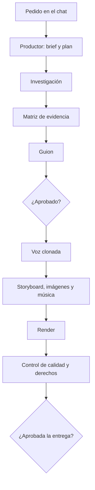

## TL;DR

**Content Lab** es una aplicación que convierte una idea contada en un chat en un paquete de contenido completo: un video explicativo con mi voz clonada, reels verticales, un artículo y posteos para redes. Lo hace un "equipo" de agentes de IA que investiga, escribe, verifica y produce, y **toda la inferencia corre en mi computadora**. Internet solo se usa para buscar fuentes y bajar imágenes con licencia libre.

En este post cuento la idea, cómo está armado y las decisiones técnicas que más me sirvieron.

---

## El problema: producir contenido de calidad lleva demasiado tiempo

Hacer un buen video explicativo no es solo grabar. Antes hay que investigar, chequear datos, escribir un guion, conseguir imágenes que se puedan usar legalmente, editar, musicalizar y subtitular. Y después adaptar todo a cada red.

Las herramientas de IA "todo en uno" resuelven parte de esto, pero con tres problemas que me molestaban:

- **Inventan cosas.** Una cifra sin fuente en un video de divulgación es un error grave.
- **Dependen de APIs pagas.** Cada video cuesta plata y tus datos viajan a otro servidor.
- **Son cajas negras.** No sabés de dónde salió cada afirmación ni podés corregir una etapa sin rehacer todo.

Content Lab nació para atacar esos tres puntos.

---

## Qué produce

A partir de un único pedido, la fábrica entrega:

| Pieza | Qué sale |
| --- | --- |
| 🎬 Video explicativo | 5–8 minutos en 16:9, con narración en mi voz, fotos, mapas, gráficos con fuente, música y subtítulos tipo karaoke |
| 📱 Reels | Hasta 5 verticales en 9:16, cada uno pensado como pieza propia (gancho, idea, cierre), no como recorte |
| 📰 Artículo | Markdown y HTML con intertítulos y enlaces a las fuentes |
| 💬 Posteos | Hilo para X, LinkedIn e Instagram, respetando los límites de cada red |

Cada entrega viene con su **dossier de investigación**, la lista de recursos usados y un semáforo de derechos y monetización.

---

## Cómo funciona: un equipo de agentes con un director que es código

La interfaz es una **oficina en pixel art** donde cada escritorio es un especialista: productor, investigador, redactor, guionista, verificador, diseñador, sonidista y editor. Mientras trabajan se ve quién está activo, qué produjo y dónde hace falta que yo intervenga.

La clave del diseño es que **el LLM no manda**. El orquestador es código común y corriente; cada agente es una llamada aislada cuya salida se valida contra un esquema. Si la respuesta no cumple el formato, no avanza.

> [!tip] La decisión que más me sirvió
> Separar "quién decide el flujo" (código determinístico) de "quién genera contenido" (el modelo). Así los errores del modelo quedan contenidos en una etapa y no contaminan el resto.

### Trazabilidad: nada sin fuente

- Cada cita es **texto literal** de una fuente guardada.
- Cada cifra sale de la evidencia y se verifica por código.
- El verificador **nunca ve el razonamiento del autor**: solo el resultado y las fuentes, para que no "se deje convencer".
- Lo que no tiene respaldo se suaviza o se marca como no confirmado.

### Yo decido en los puntos importantes

Hay compuertas de aprobación: apruebo el guion, los reels y la entrega final. Lo aprobado **nunca se sobrescribe**: si algo cambia, se guarda una versión nueva.

---

## Decisiones técnicas que valió la pena tomar

### 1. Local-first de verdad

El modelo de lenguaje, la síntesis de voz, la alineación de subtítulos y la música corren en una GPU de 24 GB. Antes de elegir el modelo base hice mediciones propias con los mismos prompts y validadores del pipeline: tiempos, cantidad de citas literales correctas y referencias inventadas. Elegí con datos, no por hype.

### 2. Un motor de workflow propio en lugar de una cola externa

En vez de sumar Redis y una librería de colas, armé un scheduler persistente sobre SQLite:

- cada transición se guarda **antes** de ejecutarse;
- si el proceso muere, las tareas huérfanas vuelven a la cola al reiniciar;
- cada etapa hashea sus entradas, así que si nada cambió **no se rehace**;
- los reintentos con backoff solo aplican a errores transitorios.

Para probarlo de verdad existe un comando que **mata el worker al azar** durante la producción y verifica que cada etapa termine exactamente una vez. Si se corta la luz, la fábrica retoma donde estaba.

### 3. Render en un proceso aparte

La API y el orquestador corren en **Bun**, pero el render de video con **Remotion** corre en un proceso de **Node** separado. Así cada runtime hace lo que mejor sabe y un render pesado no bloquea la interfaz.

### 4. Instalación para no programadores

Un script de PowerShell instala lo que falte (Bun, Node, FFmpeg, Python, Ollama), baja el modelo, crea un acceso directo y abre la app. Se puede volver a correr sin riesgo: repara lo que falte. Los motores pesados (voz, transcripción, música) se instalan desde la propia interfaz, cada uno en su entorno aislado.

---

## Stack

| Capa | Tecnología |
| --- | --- |
| API y orquestación | Bun, Hono, SQLite y un motor de workflow propio |
| Interfaz | React, Vite y shadcn/ui |
| Lenguaje y visión | Ollama con un modelo local de la familia Qwen |
| Voz | Qwen3-TTS (clonación) y faster-whisper (alineación por palabra) |
| Música | ACE-Step (opcional) |
| Video | Remotion y FFmpeg |
| Herramientas | Servidores MCP para datos oficiales, papers, Wikidata, imágenes y navegación |

El repo es un monorepo con CI que corre typecheck, lint y tests en cada push. Los tests de punta a punta usan un **LLM falso**, así que no necesitan GPU.

---

## Lo que aprendí

- **La IA rinde más cuanto más acotada está su tarea.** Un agente con una sola responsabilidad y una salida validada es mucho más confiable que un "súper prompt".
- **Reanudable no es un lujo.** Con procesos de varios minutos o más, poder retomar sin rehacer cambia la experiencia por completo.
- **Medir antes de elegir modelo** ahorra semanas de pelearse con el equivocado.
- **La experiencia de uso importa incluso en herramientas internas.** La oficina pixel art parece un detalle, pero hace que se entienda el proceso de un vistazo.

---

## Estado actual

Content Lab es un proyecto privado y personal, en desarrollo activo. Hoy lo uso para experimentar con formatos de divulgación. Si te interesa la idea de producir contenido con IA de forma local y trazable, escribime: me encanta charlar de esto.
