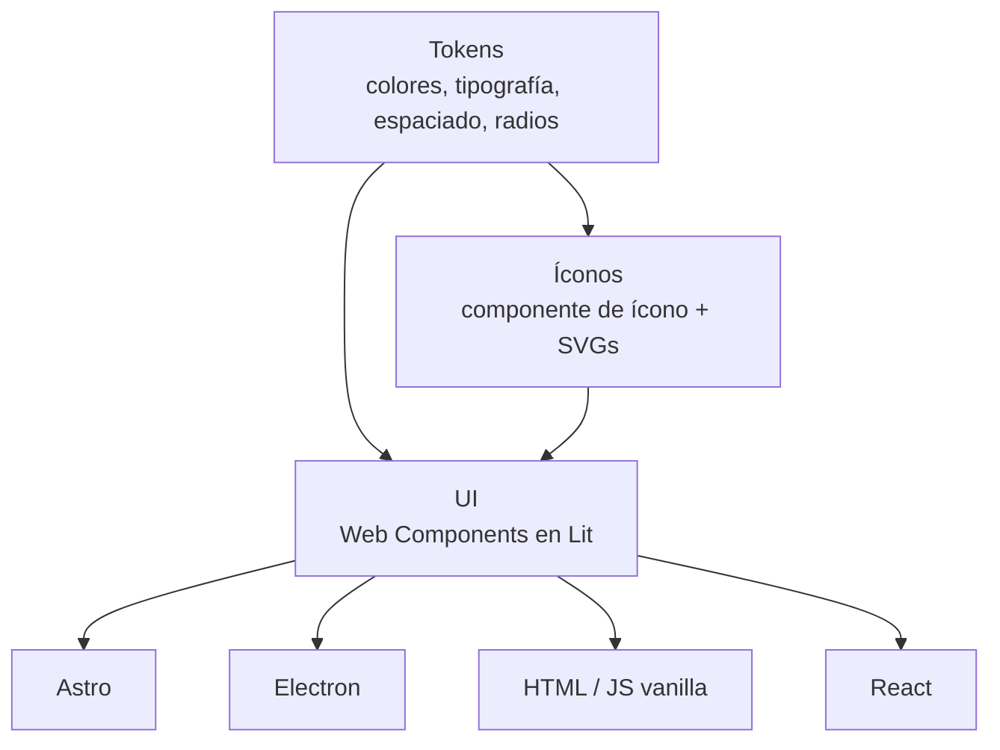

## TL;DR

En **G2M Technology Group** tenemos productos hechos con tecnologías distintas: sitios en Astro, aplicaciones de escritorio en Electron, pantallas en HTML y JavaScript plano y apps en React. Para que todos se vean y se comporten igual, construimos un **design system basado en Web Components**: funciona en cualquiera de esos entornos sin depender de un framework.

> [!note] Sobre este post
> Es un proyecto interno de mi trabajo actual. Cuento el enfoque y la arquitectura; no incluye el código ni los diseños de la empresa.

---

## El problema: un mismo botón, cinco implementaciones

Cuando cada producto usa su propio stack, pasa lo de siempre:

- el mismo componente se implementa varias veces, cada una un poco distinta;
- un cambio de marca implica tocar cada proyecto;
- la accesibilidad y los estados (hover, foco, deshabilitado) se resuelven de forma inconsistente.

Un design system en React no servía: la mitad de los productos no usa React.

---

## La solución: tres paquetes que se versionan juntos

1. **Tokens:** las decisiones de diseño (colores, tipografía, espaciados, radios) como variables CSS y TypeScript, con soporte de temas.
2. **Íconos:** un componente de ícono y la biblioteca de SVGs.
3. **UI:** los componentes, escritos como **Web Components con Lit**.

Los tres se versionan juntos y se publican de forma privada en el registry de la organización.

### Por qué Web Components

- Son un **estándar del navegador**: funcionan en cualquier framework o sin ninguno.
- Encapsulan estilos con Shadow DOM, así un CSS global no los rompe.
- **Lit** agrega lo justo (reactividad y templates) sin el peso de un framework completo.

### Temas y personalización por tokens

Cada componente usa **tokens semánticos** (por ejemplo, "fondo del botón primario") en lugar de colores fijos. Para cambiar el tema alcanza con sobrescribir variables CSS: no hace falta tocar componentes.

> [!tip] Importar solo lo que usás
> Cada componente se importa por separado. Un proyecto que solo necesita botones y formularios no carga la tabla ni el calendario.

---

## Qué incluye

Una base de componentes pensada para aplicaciones administrativas:

- botones, chips y avatares;
- formularios y carga de archivos;
- tablas, tarjetas y contenedores;
- navegación y barra lateral;
- calendario, tooltip y notificaciones tipo snackbar;
- fundamentos documentados: color, tipografía, espaciado y radios.

---

## Cómo lo mantenemos

- **Storybook** como catálogo vivo y entorno de desarrollo.
- **Custom Elements Manifest**, que describe cada componente para editores y documentación.
- **Tests de contrato** que verifican la API pública de los componentes.
- **Changesets** para versionar y generar changelogs.
- **CI** que construye, testea y publica; una **wiki** con guías de instalación, componentes y temas.
- Plantillas de issues específicas para **pedir un componente nuevo**.

---

## Stack

| Parte | Tecnología |
| --- | --- |
| Componentes | Lit (Web Components) |
| Tokens | Variables CSS y TypeScript con temas |
| Documentación | Storybook, Custom Elements Manifest y wiki |
| Calidad | ESLint, Prettier y tests de contrato |
| Publicación | Changesets y GitHub Packages |

---

## Lo que aprendí

- **Elegir estándares por sobre frameworks** paga cuando tenés productos heterogéneos.
- **Los tokens son el contrato** entre diseño y desarrollo. Si están bien nombrados, cambiar un tema es trivial.
- **Un design system es un producto interno:** necesita documentación, versionado y un canal para que el equipo pida cosas, o nadie lo adopta.
