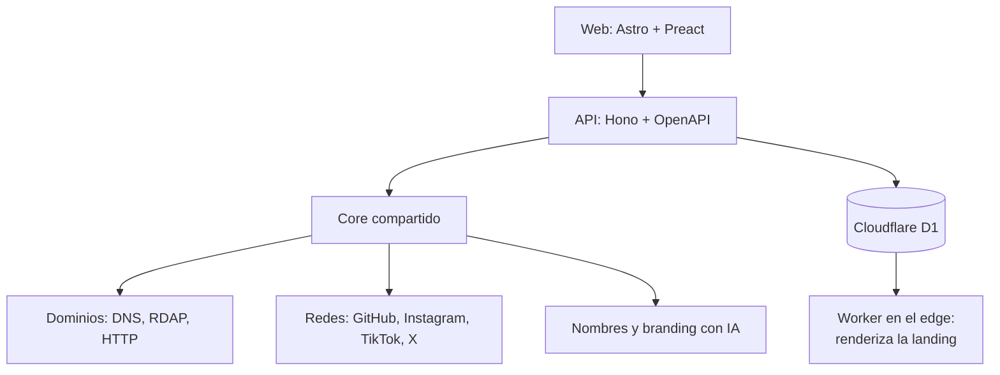

## TL;DR

En un [post anterior](/blog/foundercheck-la-herramienta-que-necesitaba) conté **por qué** construí FounderCheck: validar el nombre de una idea (dominio, redes y branding) antes de escribir una sola línea de código. Este post es la otra mitad: **cómo está hecho**.

FounderCheck empezó como un **CLI en Rust** y evolucionó a un **monorepo TypeScript** con una API en Hono, una web en Astro y un **Cloudflare Worker** que sirve las landings generadas desde el edge.

---

## De script a producto

La primera versión era una herramienta de terminal: le pasabas un nombre, revisaba dominios y usernames y, si todo estaba libre, desplegaba un template con CI/CD. Útil para mí, imposible de mostrarle a un founder no técnico.

La versión web mantiene la misma idea, con un flujo guiado:

1. Escribís un nombre, o una idea en lenguaje natural ("quiero una app de gimnasio").
2. Si es una idea, la IA propone entre 5 y 10 nombres con su justificación.
3. Para cada nombre ves la disponibilidad de dominios y redes.
4. Elegís uno, generás un **brand kit** (colores, tipografía y textos) y publicás una landing en minutos.

---

## Arquitectura

### Un core compartido

Toda la lógica vive en un paquete `core` que usan tanto la API como la web: validación de dominios, chequeo de redes, generación de nombres y branding. Así la regla de "qué cuenta como disponible" existe en un solo lugar y tiene sus propios tests.

### Verificación de dominios en tres pasos

Saber si un dominio está **realmente** libre es más difícil de lo que parece. Muchos aparecen "libres" pero están estacionados o se venden como premium. Por eso el chequeo es triple:

- **DNS:** ¿resuelve a algo?
- **RDAP:** ¿qué dice el registro oficial?
- **HTTP:** ¿hay una página de venta o de dominio premium?

Solo cuando los tres coinciden, el dominio se marca como disponible. Cada badge del resultado linkea a la verificación correspondiente, así el usuario puede confirmarlo por su cuenta.

### IA intercambiable

La generación de nombres y de branding pasa por una capa de **proveedores**: el mismo código funciona con OpenAI o con modelos compatibles. El generador también detecta el idioma del usuario y responde en el mismo.

### Landings servidas desde el edge

Las landings generadas no viven en un servidor tradicional. Se guardan en **Cloudflare D1** y un **Worker** las renderiza al vuelo según el subdominio. Es barato, escala solo y responde rápido desde cualquier lugar.

> [!tip] La API se documenta sola
> Usar `@hono/zod-openapi` hace que los esquemas de validación también generen la documentación. Swagger UI viene integrado y siempre está al día con el código.

---

## Stack

| Parte | Tecnología |
| --- | --- |
| Monorepo | Turborepo y pnpm workspaces |
| API | Hono, Zod y OpenAPI con Swagger UI |
| Web | Astro, Preact y Tailwind CSS 4 |
| Edge | Cloudflare Workers y D1 |
| IA | SDK de OpenAI con proveedores compatibles |
| CLI original | Rust con clap, tokio, reqwest y chromiumoxide |
| Calidad | Vitest en cada paquete y CI/CD con GitHub Actions |

---

## Lo que aprendí

- **Empezar por un CLI fue buena idea.** Validé la lógica rápido y sin pelearme con interfaces.
- **Un core compartido** evita que la API y la web cuenten historias distintas sobre el mismo dato.
- **"Disponible" es una palabra peligrosa.** Sin el chequeo triple, la herramienta habría mentido justo en lo más importante.
- **El edge es ideal para contenido generado:** muchas landings pequeñas, poco tráfico cada una y cero servidores que mantener.

Si querés leer la motivación detrás del proyecto, está en [este post](/blog/foundercheck-la-herramienta-que-necesitaba).
