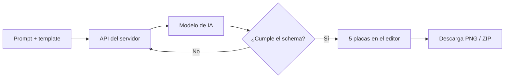

## TL;DR

Para el marketing de [Mi Vidriera](/blog/mi-vidriera-vidrieras-online-para-emprendedores) necesitaba publicar carruseles en Instagram con frecuencia. Armar cada uno en un editor de diseño me llevaba demasiado tiempo, así que hice una herramienta: escribís **de qué trata** el carrusel, elegís un estilo y la app genera **5 placas** con el texto puesto sobre los templates de la marca, listas para descargar en PNG.

---

## El problema: el contenido constante cansa

Los carruseles funcionan muy bien en Instagram, pero hacerlos tiene varios pasos repetitivos:

- pensar una estructura que enganche (gancho, desarrollo, cierre);
- escribir textos cortos que entren en cada placa;
- mantener la identidad visual de la marca;
- exportar cada placa con el tamaño correcto.

La parte creativa es la idea. Todo lo demás se puede automatizar.

---

## Cómo funciona

1. Elegís un **template**: amarillo, blanco o negro, los colores de la marca.
2. Escribís el tema, por ejemplo: *"un carrusel sobre cómo aumentar ventas con WhatsApp para dueños de negocios chicos"*.
3. El servidor le pide al modelo **exactamente 5 placas**, con un rol para cada una (portada, desarrollo y llamado a la acción).
4. La respuesta se **valida con Zod**: si el modelo no devuelve el formato exacto, no se usa.
5. Las placas se renderizan sobre los fondos PNG de 1024×1024, se pueden **editar** y se descargan una por una o todas juntas en un ZIP.

---

## Decisiones técnicas

### Salida estructurada, siempre

El error más común al integrar IA es confiar en que el modelo "va a responder bien". Acá el contrato es un **schema de Zod**: cantidad de placas, campos de cada una y largo de los textos. Si no cumple, se rechaza. Así el frontend nunca recibe algo que no sabe dibujar.

### La API key nunca toca el navegador

La llamada al modelo se hace en un **endpoint del servidor** de Astro (con el adapter de Node). El cliente solo manda el prompt y el template.

### Renderizar en el navegador

Cada placa es HTML y CSS sobre el fondo del template. Para exportarla uso `html-to-image`, que la convierte en PNG del lado del cliente, y `jszip` para descargar todo junto. No hace falta un servidor de renderizado.

> [!tip] Los templates son la marca
> Separar el **fondo** (diseñado una vez, en PNG) del **texto** (generado cada vez) mantiene la identidad visual sin depender de que la IA "diseñe".

---

## Stack

| Parte | Tecnología |
| --- | --- |
| Framework | Astro con el adapter de Node e islas de React |
| IA | Gemini 2.5 Flash vía SDK oficial |
| Validación | Zod |
| Exportación | html-to-image, jszip y file-saver |

---

## Lo que aprendí

- **Automatizá lo repetitivo, no lo creativo.** La idea del carrusel la sigo pensando yo; la herramienta hace el resto.
- **Un schema estricto es la mejor forma de domar a un LLM.**
- **Herramientas internas chicas tienen un retorno enorme:** esta app me ahorra horas por semana y la hice en pocos días.

Este generador es la semilla de algo más ambicioso que estoy construyendo: [Content Lab](/blog/content-lab-fabrica-local-de-contenido-con-ia), una fábrica de contenido completa que corre en local.
