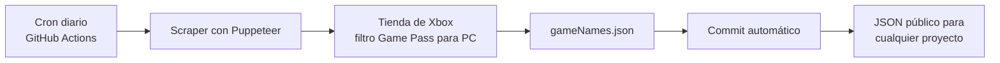

## TL;DR

**[Games available on Game Pass](https://github.com/NicoTomasin/Games-available-on-Game-Pass)** es un scraper que obtiene la lista de juegos de **PC Game Pass** directamente desde la tienda de Xbox y la guarda en un archivo JSON. Un workflow de **GitHub Actions** lo ejecuta todos los días y commitea los cambios, así que la lista siempre está al día, sin servidores y sin costo.

Hoy la lista tiene unos **590 juegos** y el workflow lleva **más de 1.300 ejecuciones**.


---

## La idea

Juego en PC y quería saber, mientras navegaba Steam, si un juego **ya estaba incluido en Game Pass** antes de comprarlo. Microsoft no ofrece una API pública simple para eso, así que la solución fue:

1. un **scraper** que arme la lista;
2. un **JSON público** con el resultado;
3. una **extensión de Chrome** (de uso personal) que lee ese JSON y marca los juegos en Steam.

---

## Cómo funciona



### El scraper

Con **Puppeteer** abre la página de la tienda de Xbox en modo headless y:

- aplica los filtros de **suscripción → Game Pass para PC**;
- hace click en **"Cargar más"** hasta que no quedan juegos;
- extrae los títulos, los normaliza a minúsculas y escribe el JSON.

La tienda carga todo de forma asíncrona y los botones aparecen cuando quieren, así que armé una función de **click con reintentos**: prueba varias veces con un pequeño delay incremental antes de darse por vencida. Eso hizo que el scraper pase de fallar seguido a ser estable.

> [!tip] Scraping robusto
> En páginas dinámicas, no asumas que un elemento ya está. Reintentar con un tiempo máximo es mucho más confiable que poner `sleep` fijos.

### La automatización

El workflow corre **todos los días a la medianoche (UTC)**:

1. instala Bun y las dependencias;
2. ejecuta el scraper;
3. si `gameNames.json` cambió, hace commit y push.

Si no hay cambios, no commitea nada. El historial del repo se convierte, de paso, en un registro de qué juegos entraron y salieron del catálogo.

---

## Cómo usar la lista

Cualquiera puede consumir el JSON sin instalar nada:

```js
const res = await fetch(
  "https://raw.githubusercontent.com/NicoTomasin/Games-available-on-Game-Pass/main/gameNames.json"
);
const games = await res.json();
const isOnGamePass = (title) => games.includes(title.toLowerCase());
```

---

## Stack

| Parte | Tecnología |
| --- | --- |
| Scraping | Puppeteer |
| Runtime | Bun |
| Automatización | GitHub Actions con cron diario |
| "Base de datos" | Un archivo JSON versionado en Git |

---

## Lo que aprendí

- **GitHub Actions es un cron gratis** para tareas chicas y periódicas.
- **Git como base de datos** funciona perfecto para datos chicos que cambian poco: tenés historial, diffs y hosting gratis.
- **El scraping se rompe:** cuando la tienda cambia su HTML, hay que ajustar los selectores. Los reintentos y los logs claros hacen que arreglarlo sea rápido.

El proyecto es open source con licencia MIT y está en [GitHub](https://github.com/NicoTomasin/Games-available-on-Game-Pass).
