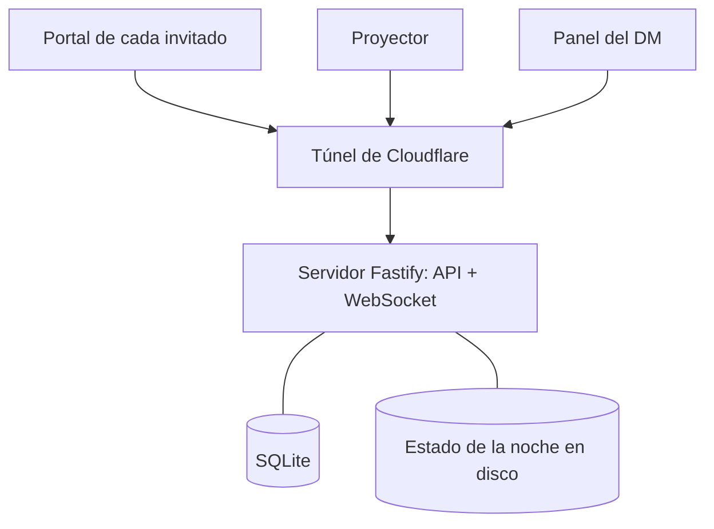

## TL;DR

Para mi cumpleaños no quería una fiesta más: quería una **experiencia**. Así nació **La Señal**, un juego de rol para catorce invitados donde una entidad alienígena aparece proyectada en la pared y solo se comunica con **glifos**. Cada invitado aprende parte del idioma antes de la fiesta desde su celular, y esa noche todos tienen que entenderse con ella (y entre ellos) para decidir cómo termina la historia.

Detrás hay una web en tiempo real, un generador de glifos, realidad aumentada, imágenes generadas con IA en local y un panel para que yo dirija la partida como **DM**.

---

## La idea: Arrival, pero en el living

La inspiración es la película *Arrival*: alguien que no habla tu idioma, y un grupo que tiene que descifrarlo. La premisa:

- Dos semanas antes, cada invitado recibe una **credencial impresa** con un QR.
- El QR abre su **portal personal**: una cuenta regresiva, un tráiler y los primeros glifos para aprender, mirando escenas ilustradas.
- Más cerca de la fecha aparece **su personaje**, con una historia secreta y rasgos propios.
- La noche de la fiesta aparece la entidad. Los invitados le escriben con glifos desde el celular y ella contesta en la pantalla grande.
- Al final, cada uno decide **en secreto** si vuelve a su realidad o se queda con el grupo.

> [!tip] El giro que lo hace divertido
> No todos aprendieron el idioma igual. Hay información oculta, y lo que otro jugador te dice que significa un glifo puede ser verdad... o no.

---

## Un cambio de rumbo a mitad de camino

El diseño original tenía a la entidad manejada por un **modelo de IA local**, restringido para contestar solo con glifos del vocabulario, y una "barra de confianza" automática.

A mitad del desarrollo lo cambié por completo: la entidad pasó a decir **lo que yo elijo** desde un panel, como un Dungeon Master humano. La razón fue simple: en una fiesta, el ritmo y la lectura del grupo valen más que la autonomía. Un DM puede improvisar, acelerar o darle protagonismo a alguien callado; un modelo no.

Lo que sobrevivió del diseño original fue lo mejor: el idioma, las credenciales, la decodificación previa y la realidad aumentada.

---

## Las piezas del sistema

### El idioma, generado por código

Los glifos no están dibujados a mano: un paquete genera cada uno como **SVG a partir de una semilla**, junto con sellos para la realidad aumentada y un logograma. Todo el contenido (vocabulario, escenas, personajes y guion) vive en archivos JSON que son la **única fuente de verdad**; la web y las herramientas los leen de ahí.

### El portal de cada invitado

Una **PWA** hecha con Preact y Vite. Cada invitado entra con un token único desde su QR y ve su cuenta regresiva, su personaje y los glifos que va aprendiendo. Tiene notificaciones push para avisar cuando hay contenido nuevo y un modo de realidad aumentada con **MindAR** para "escanear" la credencial.

### El proyector

La pantalla grande muestra a la entidad, los glifos que dice, la narración y las tiradas de dados. Los dados son **físicos**: cada uno tira un d6, suma su rasgo y el resultado aparece en el proyector y en los celulares.

### El panel del DM

Desde el celular controlo la noche:

- **Guion:** cada momento de la historia se lanza con un toque.
- **Bandeja:** veo qué mandó cada jugador, qué dice de verdad y qué cree que dice.
- **Hablar:** la entidad dice algo, narro, anuncio una tirada o le susurro a una sola persona.
- **Jugadores:** puedo enseñarle un glifo a alguien o darle un logro.

---

## Arquitectura

- Un único servidor **Fastify** sirve la API para la etapa previa (HTTP) y la partida en vivo (**WebSocket**).
- Corre en una computadora de mi casa y se expone con un **túnel de Cloudflare**, sin abrir puertos.
- El estado de la noche se guarda en disco en cada cambio: si el servidor se reinicia, la partida sigue donde estaba.

---

## Stack

| Capa | Tecnología |
| --- | --- |
| Web | Preact, Vite, PWA con notificaciones push |
| Tiempo real | Fastify y WebSockets |
| Datos | SQLite nativo de Node |
| Realidad aumentada | MindAR y three.js |
| Arte | Escenas generadas con ComfyUI en una GPU local |
| Organización | Monorepo con pnpm, paquetes de core y glifos con tests |

---

## Lo que aprendí

- **La tecnología tiene que desaparecer.** Nadie en una fiesta quiere instalar una app ni crear una cuenta: un QR y un link es todo.
- **Humano antes que IA cuando importa el ritmo.** La IA es genial para generar arte y contenido; para conducir una experiencia en vivo, el criterio humano ganó.
- **El contenido como datos** permitió cambiar la historia completa sin tocar la lógica.
- **Diseñar para el error en vivo:** guardar estado en cada cambio me dio tranquilidad para la noche real.

Fue uno de los proyectos más divertidos que hice: programar algo cuyo único objetivo es que tus amigos la pasen bien.
