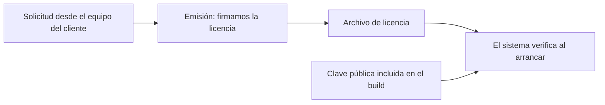

## TL;DR

Parte del software que hacemos en **G2M Technology Group** se instala **en los servidores del cliente**, muchas veces sin acceso a internet. Para proteger esas instalaciones armamos un esquema de **licencias offline**: cada licencia está **firmada digitalmente** por nosotros, queda **atada al equipo** donde corre el sistema y se verifica al arrancar, sin consultar ningún servidor externo.

> [!note] Sobre este post
> Es una herramienta interna de seguridad. A propósito, el post se queda en el concepto general: no incluye detalles de implementación, de verificación ni de las señales que se usan, para no facilitar que alguien intente evadirla.

---

## El problema: proteger software que no puede "llamar a casa"

Los esquemas de licencia típicos validan contra un servidor de activación. En entornos on-premise eso no siempre es posible:

- la red del cliente puede no tener salida a internet;
- depender de un servidor externo agrega un punto de falla;
- si nuestro servidor está caído, el sistema del cliente no debería dejar de funcionar.

Necesitábamos algo que funcione **100% offline** y que, aun así, impida copiar una instalación a otro equipo.

---

## El enfoque general

1. **Solicitud:** en el equipo donde va a correr el sistema se genera una solicitud con información que identifica a esa máquina. No incluye datos del producto ni del cliente.
2. **Emisión:** con esa solicitud emitimos una licencia y la **firmamos con nuestra clave privada**, usando criptografía de curva elíptica (Ed25519).
3. **Verificación:** el sistema incluye la **clave pública** y verifica la firma y la correspondencia con el equipo al iniciar. Si algo no coincide, no arranca.

La clave privada **nunca sale de la empresa**: sin ella, nadie puede fabricar una licencia válida.

> [!tip] Por qué firmas y no "códigos secretos"
> Con firmas digitales, el software solo necesita la clave pública para verificar. Aunque alguien inspeccione el build, no puede generar licencias nuevas.

---

## El proceso importa tanto como el código

Un esquema de licencias falla más por la operación que por la criptografía. Por eso documentamos:

- **custodia de claves:** las claves privadas viven fuera del repositorio, del registry y de los logs de CI, con backups cifrados;
- **verificación administrativa** de cada solicitud antes de emitir;
- **reemplazo atómico** del archivo de licencia en el servidor del cliente;
- **rotación de claves** sin cortar el servicio: primero se distribuye la nueva clave pública junto a la anterior y recién después se emite con la nueva;
- **mudanza de equipo:** se emite una licencia nueva y se registra la baja de la anterior.

---

## Integración con nuestros proyectos

La herramienta se distribuye como un paquete interno con:

- un **CLI** para generar claves, emitir y auditar licencias;
- una **integración para Astro** que verifica la licencia al iniciar la aplicación;
- ejemplos para otros backends;
- tests y un flujo de release automatizado.

---

## Stack

| Parte | Tecnología |
| --- | --- |
| Lenguaje | TypeScript sobre Bun |
| Criptografía | Firmas Ed25519 |
| Integración | Astro y otros backends de Node |
| Distribución | Registry privado de la organización |
| Calidad | Tests y CI/CD en GitHub Actions |

---

## Lo que aprendí

- **"Offline" cambia el modelo de amenazas:** no podés revocar nada en tiempo real, así que el proceso administrativo es parte de la seguridad.
- **La criptografía bien elegida simplifica todo:** con firmas, el software no guarda ningún secreto.
- **Documentar la operación** (emitir, reemplazar, rotar) es lo que hace que un esquema así sea usable por un equipo y no solo por quien lo programó.
