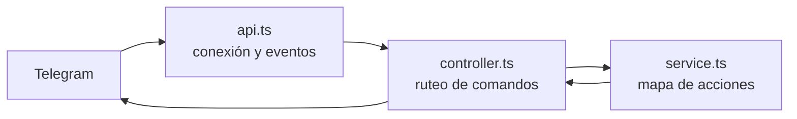

## TL;DR

Este fue mi **primer bot de Telegram**: unas pocas líneas de TypeScript con `node-telegram-bot-api`. No hace nada espectacular, pero de acá salió un patrón que sigo usando en todos mis bots: **separar la conexión con Telegram, el ruteo de comandos y las acciones**.

---

## Qué hace

- Con `/start` muestra un **teclado de botones** con los comandos disponibles.
- Cada botón dispara una acción, por ejemplo iniciar un registro pidiendo el email o despedirse.
- Si llega un comando desconocido, responde con un mensaje amable en lugar de fallar.

---

## La estructura: tres archivos, tres responsabilidades

- **`api.ts`:** crea el bot, lee el token desde variables de entorno y escucha los eventos.
- **`controller.ts`:** recibe el comando elegido, valida que el mensaje tenga lo necesario y busca la acción.
- **`service.ts`:** un **mapa de nombre de comando → función**. Agregar un comando nuevo es agregar una entrada.

El teclado de `/start` se genera **a partir del mismo mapa de acciones**, así que nunca queda desactualizado.

> [!tip] El patrón que me llevé
> "Los comandos son datos": un mapa de acciones del que salen tanto el menú como el ruteo. Lo volví a usar en bots en Rust mucho más grandes.

---

## Lo que aprendí

- **Empezar chico está bien.** Este bot fue un experimento de una tarde y me dio la base para todo lo que vino después.
- **Separar responsabilidades desde el primer día** hace que crecer no duela.
- **Validar lo que llega de afuera:** los callbacks de Telegram pueden venir incompletos, y chequearlo evitó errores raros.

---

## Lo que vino después

Con este patrón como base construí bots más ambiciosos:

- [MiAutoFeo](/blog/miautofeo-bot-mantenimiento-auto-lenguaje-natural), para registrar el mantenimiento del auto en lenguaje natural.
- [Un bot de ahorro en BTC](/blog/bot-telegram-rust-disciplina-btc), con indicadores técnicos y portfolio.
- [Runtime Bots](/blog/runtime-bots-plataforma-multi-tenant-rust), una plataforma para correr muchos bots aislados.
