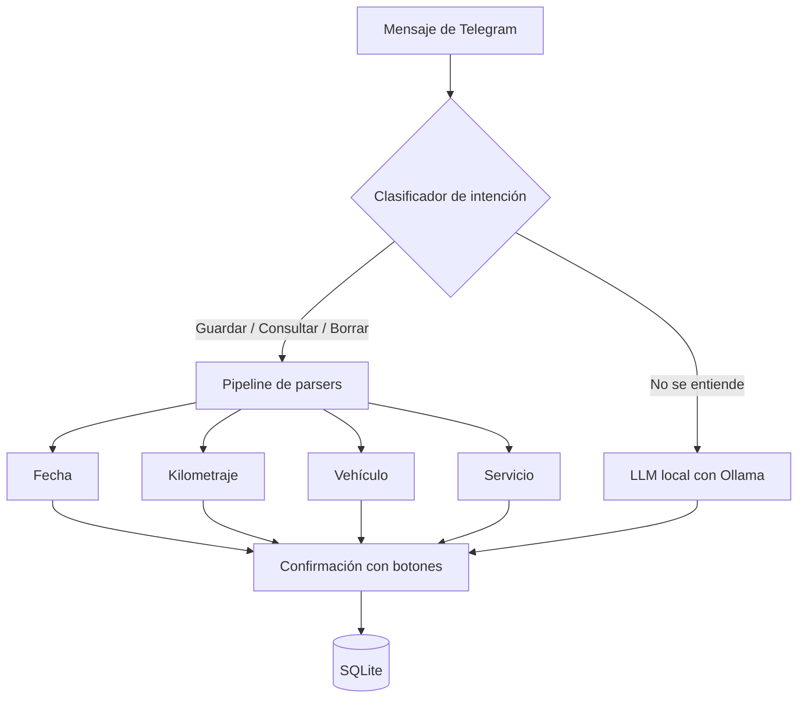

## TL;DR

**MiAutoFeo** es un bot de Telegram para llevar el historial de mantenimiento del auto escribiendo en **español argentino**, como le hablarías a un amigo: *"cambié el aceite del gol el 5 de marzo"* o *"le hice frenos al corsa ayer a los 120000 km"*.

El truco está en la arquitectura: un **parser determinista** escrito en Rust resuelve la gran mayoría de los mensajes, y un **modelo de lenguaje local** con Ollama entra solo cuando el parser no puede, en alrededor del 15% de los casos.

---

## El problema: nadie completa formularios para anotar un cambio de aceite

Llevar el registro del service del auto es útil: sabés cuándo toca el próximo cambio, tenés historial para vender el auto y no te olvidás de nada. Pero nadie lo hace, porque abrir una app y completar un formulario con fecha, kilometraje y tipo de servicio da fiaca.

Mandar un mensaje de Telegram, en cambio, no cuesta nada.

---

## Ejemplos de lo que entiende

```text
"cambié el aceite del gol el 5 de marzo"
"le hice frenos al corsa ayer a los 120000 km"
"cambio de bujías al fiesta"
"mostrame el último cambio de aceite"
"historial del gol"
"borrá el último cambio de aceite del gol"
```

Con esos mensajes el bot guarda, consulta y borra registros, siempre con un **botón de confirmación** antes de escribir en la base.

---

## Arquitectura: reglas primero, IA de respaldo



### 1. Clasificar la intención

Primero, con expresiones regulares, el bot decide si el mensaje quiere **guardar**, **consultar** o **borrar** algo. Es rápido y predecible.

### 2. Un parser especializado por dato

Cada dato tiene su propio parser:

- **Fechas:** entiende "ayer", "el 5 de marzo", "la semana pasada".
- **Kilometraje:** "a los 120000 km", "120 mil", "120.000".
- **Vehículo:** busca marcas y modelos con **matching difuso** (con la librería `strsim`), así que "el gol", "gol trend" o un error de tipeo llevan al mismo auto.
- **Servicio:** reconoce componentes y tipos de servicio ("aceite", "frenos", "bujías", "distribución").

Los datos de referencia (marcas, modelos con sus alias, componentes y servicios) viven en archivos JSON editables, pensados para los autos más comunes en Argentina.

### 3. El LLM solo cuando hace falta

Si el pipeline no logra resolver el mensaje, se lo pasa a un **modelo chico corriendo en Ollama** (de 0.5B a 1.5B parámetros alcanza). El modelo extrae los datos y el bot igual pide confirmación.

> [!tip] Por qué no todo con IA
> Un parser determinista es **instantáneo, gratis y predecible**. Usar el LLM como respaldo y no como motor principal hace que el bot sea rápido, barato de correr y que sus errores sean fáciles de depurar.

---

## Otros detalles

- **Mini app de Telegram:** una vista web dentro de Telegram para ver los autos y el historial completo, y borrar registros.
- **Control de acceso:** un administrador habilita o deshabilita usuarios desde comandos.
- **Liviano:** arranca en unos 100 ms y corre tranquilo en un servidor mínimo.

---

## Stack

| Parte | Tecnología |
| --- | --- |
| Lenguaje | Rust con tokio |
| Telegram | teloxide, con mini app web |
| Parsing | regex, chrono y strsim (matching difuso) |
| IA de respaldo | Ollama con modelos chicos (Qwen 2.5, Phi-3) |
| Datos | SQLite con rusqlite |

---

## Lo que aprendí

- **La mayoría de los problemas de "lenguaje natural" son bastante acotados.** Con buenas reglas y datos de referencia se cubre casi todo.
- **La IA como respaldo** es una arquitectura que repito cada vez más: rápida en el caso común, flexible en el raro.
- **Confirmar antes de guardar** compensa cualquier error de interpretación y le da confianza al usuario.
- **El español rioplatense tiene sus mañas.** Diseñar para "le hice frenos" en vez de "realicé un mantenimiento de frenos" hizo toda la diferencia.
