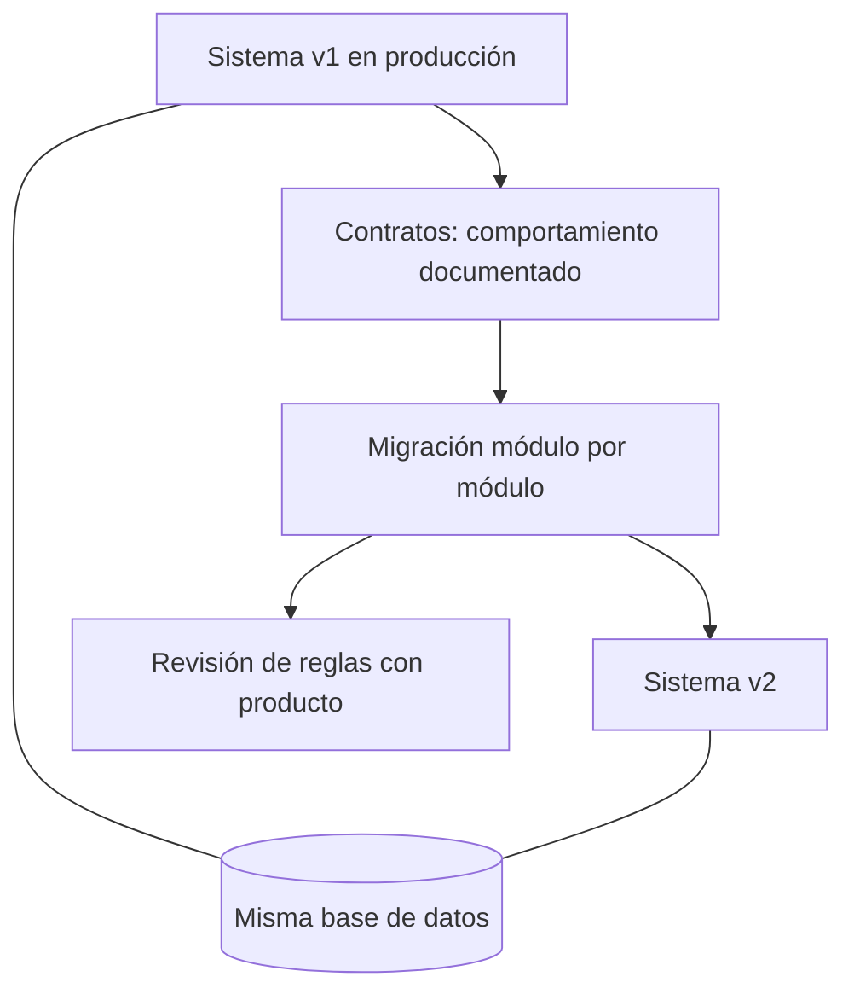

## TL;DR

En **G2M Technology Group** estamos reescribiendo una herramienta interna de gestión de encuestas. La versión original está hecha en **PHP y jQuery** y la nueva en **Bun y Astro**. La clave fue no hacer un "big bang": el sistema viejo sigue en producción mientras el nuevo crece **módulo por módulo**, sobre la **misma base de datos** y guiado por **contratos escritos a partir del comportamiento real** del sistema viejo.

> [!note] Sobre este post
> Es un proyecto interno de mi trabajo actual. Cuento la estrategia de migración y el stack; no incluye detalles funcionales, de datos ni de infraestructura.

---

## El punto de partida

El sistema original funcionaba, pero era difícil de mantener:

- una API tipo RPC concentrada en un único archivo muy largo;
- pantallas con mucha lógica en JavaScript global;
- reglas de negocio repartidas entre el servidor y el navegador.

Reescribirlo de cero y "cambiar todo un viernes" era demasiado riesgoso para una herramienta que se usa a diario.

---

## La estrategia

### 1. Contratos antes que código

Antes de escribir la v2, documentamos cómo se comporta la v1 **como contratos**: una ficha por acción de la API, las pantallas que existen y las reglas que valen para todo el sistema. La idea es poder reimplementar **sin tener que leer el código viejo** cada vez.

Esos documentos incluyen dos listas que resultaron muy valiosas:

- **lo que no hay que replicar:** bugs y comportamientos raros de la v1 que no queremos heredar;
- **lo que está muerto:** acciones que ya nadie usa y no vale la pena migrar.

### 2. La misma base de datos

La v2 se conecta a la **misma base** que la v1. Eso permite comparar ambos sistemas con exactamente los mismos datos durante la migración y detectar diferencias rápido.

> [!warning] Cuidado con producción
> Compartir la base exige disciplina. Las pruebas que escriben datos se hacen contra una **base local con el mismo esquema**, y el script que carga datos de ejemplo **se niega a correr** si la base no es claramente de desarrollo.

### 3. Módulo por módulo, con producto en el loop

La migración avanza por módulos, en un orden definido: primero autenticación y permisos, después los ABM principales, y al final lo público. Cuando aparece una regla ambigua, se documenta como una **pregunta para producto** y se ratifica antes de cerrarla, en lugar de que el desarrollador la decida por su cuenta.

### 4. Convivencia y retiro

Repositorio nuevo, sin ramas eternas. La v1 sigue recibiendo arreglos mientras haga falta; cuando la v2 la reemplace, se etiqueta su versión final y se archiva.

---

## El stack nuevo

| Pieza | Elección |
| --- | --- |
| Runtime | Bun (también como gestor de paquetes y test runner) |
| Framework | Astro en modo servidor: páginas y API en un solo despliegue |
| Base de datos | La misma base MySQL de la v1, con `mysql2` |
| Frontend | HTML, CSS y JS nativos, con islas de Astro donde hace falta interactividad |
| UI | El design system de la empresa |
| Calidad | Tests unitarios y de punta a punta, y registros de decisiones (ADRs) |

La elección de **no usar un framework de UI** fue deliberada: es una herramienta de gestión, y HTML y CSS bien hechos, con islas puntuales, cubren lo que necesita con menos complejidad.

---

## Lo que aprendí como PM y líder técnico

- **Documentar el sistema viejo es la mitad de la migración.** Una vez que el comportamiento está escrito, reescribir es mucho más predecible.
- **Decidir qué no migrar** ahorra tanto trabajo como migrar bien.
- **Las reglas de negocio son de producto.** Hacer explícitas las dudas y ratificarlas evita reproducir errores o inventar comportamientos.
- **Convivir es más seguro que reemplazar de golpe.** El usuario no se entera de la migración hasta que la nueva versión está lista.
