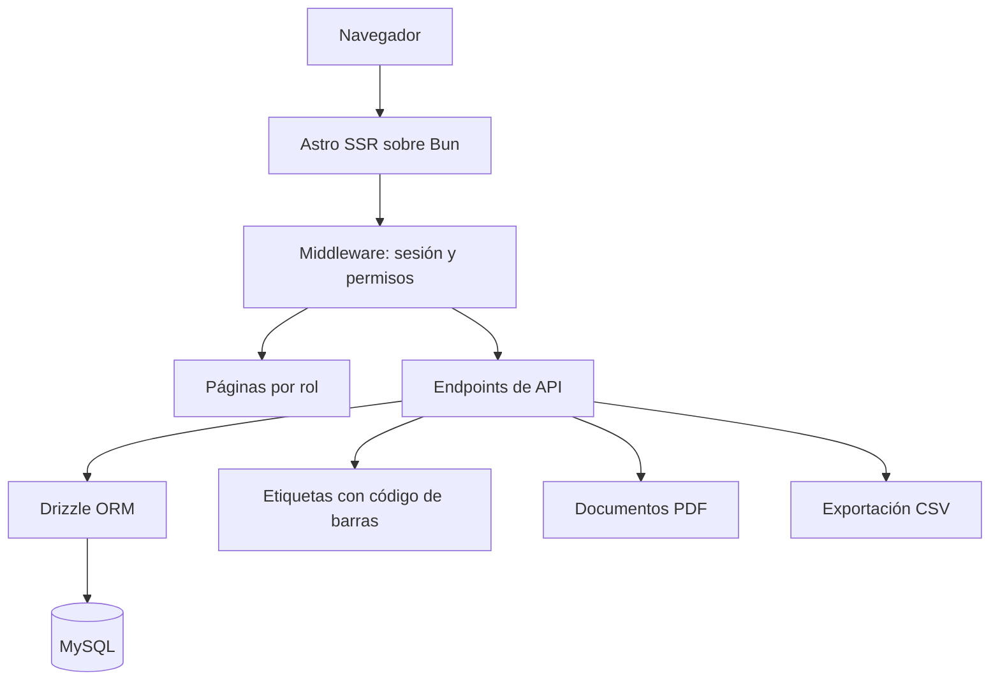

## TL;DR

En **G2M Technology Group** necesitábamos una forma simple de **coordinar envíos entre distintas ubicaciones**: qué se arma, qué sale, qué llega y qué falta. En lugar de un sistema grande, encaramos un **MVP web** con Astro en modo servidor, que genera **etiquetas con código de barras y documentos PDF** desde el propio servidor.

> [!note] Sobre este post
> Es un producto de mi trabajo actual. Cuento el enfoque y el stack; no incluye procesos, datos ni detalles de clientes.

---

## El problema

Cuando varias sedes se mandan material entre sí, la coordinación suele vivir en planillas y mensajes. Eso genera:

- poca visibilidad de qué está en camino;
- errores al armar y al recibir;
- reportes que se arman a mano.

El objetivo del MVP era **resolver el flujo principal de punta a punta** con lo mínimo indispensable, y aprender de su uso real antes de crecer.

---

## Cómo está armado

### Un solo proyecto, un solo despliegue

Astro en **modo servidor** permite tener las páginas y la API en el mismo proyecto. Para un MVP es ideal: menos piezas para desplegar y mantener.

### Datos con Drizzle

El esquema está definido en TypeScript con **Drizzle ORM**, con migraciones generadas y aplicadas por comando. El build de producción aplica las migraciones antes de generar el artefacto, así la base y el código nunca quedan desfasados.

### Documentos generados en el servidor

- **Etiquetas con código de barras** con `bwip-js`.
- **Documentos PDF** con `pdf-lib`.
- **Exportación a CSV** para quien prefiere seguir trabajando en planillas.

### Una versión de escritorio liviana

Para puestos de trabajo que lo necesitan, existe un empaquetado de escritorio que envuelve la aplicación web, sin duplicar código.

---

## Tests escritos como casos de uso

Los tests no están organizados por archivo técnico, sino por **caso de uso**: cada uno describe un escenario completo (armar, enviar, recibir, reponer, reportar, editar como administrador). Así:

- se leen casi como una especificación funcional;
- cuando algo se rompe, el nombre del test dice **qué flujo** se rompió;
- sirven como red de seguridad para iterar rápido.

> [!tip] El mejor documento de un MVP son sus tests
> Si los casos de uso están escritos como tests, la especificación nunca queda desactualizada.

---

## Stack

| Parte | Tecnología |
| --- | --- |
| Runtime | Bun |
| Framework | Astro en modo servidor con el adapter de Node |
| Datos | MySQL con Drizzle ORM |
| Documentos | bwip-js (códigos de barras) y pdf-lib |
| Íconos | Lucide |
| Calidad | Tests por caso de uso con el runner de Bun |

---

## Lo que aprendí como PM

- **Un MVP es una decisión de alcance,** no de calidad: pocas funciones, pero bien resueltas y testeadas.
- **Generar documentos en el servidor** simplifica mucho la operación: nadie depende de una plantilla en su computadora.
- **Escuchar el uso real** del MVP nos dio más información que cualquier reunión de requerimientos.
