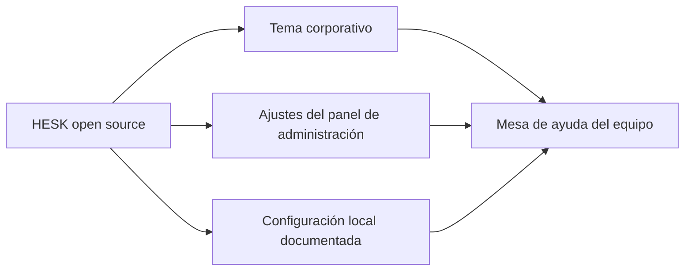

## TL;DR

En **G2M Technology Group** necesitábamos una **mesa de ayuda** para gestionar pedidos de soporte. La tentación de un equipo de desarrollo es construirla. En lugar de eso, **adaptamos HESK**, un helpdesk open source maduro, con la identidad visual de la empresa y algunas personalizaciones. Fue una de las decisiones de producto más rentables del año.

> [!note] Sobre este post
> Es una herramienta interna de mi trabajo actual. Cuento la decisión y el enfoque, sin datos, configuraciones ni información de clientes.

---

## Construir vs. adoptar

Un sistema de tickets parece simple: un formulario, una lista y un estado. Pero un helpdesk útil necesita mucho más:

- notificaciones por email y respuestas desde el panel;
- estados, prioridades y campos personalizados;
- asignación a responsables y colaboradores;
- base de conocimiento con sugerencias de artículos;
- adjuntos, búsqueda, archivo y reportes;
- protección contra spam, bloqueo de IPs y emails, y **autenticación de dos factores**;
- herramientas de privacidad como la anonimización de tickets.

Construir todo eso lleva meses. **No es el negocio de la empresa**, y cada hora invertida ahí es una hora menos en los productos que sí lo son.

> [!tip] La pregunta que me hago como PM
> ¿Esto es lo que nos diferencia? Si la respuesta es no, primero busco algo que ya exista y funcione.

---

## Qué hicimos

- **Identidad visual:** tema propio para el portal de clientes y el panel de administración, con estilos y scripts corporativos que **sobrescriben** el tema base sin modificar el núcleo.
- **Personalizaciones acotadas** en una carpeta separada, para poder actualizar HESK sin perder los cambios.
- **Guía de instalación local** para el equipo: crear la base, correr el instalador, activar la prevención de spam y **cerrar el instalador** al terminar.
- La configuración con credenciales **nunca se versiona**: cada desarrollador genera la suya.

---

## Stack

| Parte | Tecnología |
| --- | --- |
| Helpdesk | HESK (PHP) |
| Base de datos | MySQL |
| Personalización | CSS y JavaScript corporativos sobre el tema base |
| Entorno local | XAMPP |

---

## Lo que aprendí

- **La mejor línea de código es la que no escribís.** Adoptar software maduro también es ingeniería.
- **Personalizar sin modificar el núcleo** es la clave para no quedar atado a una versión vieja.
- **Documentar la instalación** convierte una herramienta "que solo sabe configurar una persona" en algo del equipo.
- **Seguridad básica desde el inicio:** CAPTCHA, 2FA y configuración fuera del repo no son opcionales, aunque sea una herramienta interna.
