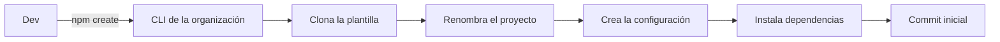

## TL;DR

En el equipo que lidero en **G2M Technology Group** arrancábamos seguido aplicaciones web administrativas, y cada una empezaba igual: login, roles, usuarios, estructura de carpetas, CI. Para dejar de repetir ese trabajo armamos una **plantilla base institucional** y un **CLI** que genera un proyecto nuevo, listo para desarrollar, con un solo comando.

> [!note] Sobre este post
> Es un proyecto interno de mi trabajo actual. Cuento la idea y las decisiones técnicas generales; no incluye código ni detalles de los productos que se construyen sobre esta base.

---

## El problema: el día uno de cada proyecto

Cada proyecto nuevo pasaba por la misma secuencia:

- configurar el frontend y el backend;
- implementar autenticación;
- modelar roles y permisos;
- armar la administración de usuarios;
- configurar lint, tests y CI.

Eso no solo lleva tiempo: además, cada proyecto terminaba resolviéndolo **un poco distinto**, y mantener muchas variantes de lo mismo se vuelve caro.

---

## La solución: una plantilla + un CLI

Un comando crea el proyecto: clona la plantilla, la renombra, genera la configuración, instala dependencias y hace el primer commit. El dev arranca directamente con la funcionalidad del producto.

### Qué trae de fábrica

- **Login** con sesión en cookie segura.
- **Roles y permisos (RBAC)** con política de "denegar por defecto" en la API.
- **Administración de usuarios** con búsqueda, paginación, alta, asignación de roles y desactivación, que además cierra las sesiones abiertas.
- Integración con el **design system** de la empresa.

---

## Decisiones técnicas

### Arquitectura hexagonal con límites verificados

La plantilla es un **monolito modular** con arquitectura limpia/hexagonal. Las reglas de dependencia entre capas no son solo una convención: **ESLint las verifica** y el CI falla si alguien las rompe.

### Contratos con OpenAPI

El backend valida con **Zod** y expone su contrato en **OpenAPI**, que también sirve como documentación viva de la API.

### Pocas piezas, fáciles de instalar

Una decisión deliberada fue **simplificar el entorno**: todo se instala con npm sobre Node LTS, sin herramientas extra. Para un equipo, que el proyecto arranque igual en todas las máquinas vale más que cualquier optimización.

### La plantilla se prueba a sí misma

Además de los tests de la aplicación (unitarios, de integración contra una base efímera y end-to-end con Playwright), hay un workflow que **genera un proyecto desde la plantilla y verifica que funcione**. Si un cambio rompe la generación, nos enteramos antes que el resto del equipo.

> [!tip] Documentación pensada también para agentes de IA
> La plantilla incluye instrucciones y "skills" para asistentes de código. Así, cuando alguien trabaja con IA, el asistente sigue las mismas convenciones que el equipo.

---

## Stack

| Área | Tecnología |
| --- | --- |
| Frontend | React, Vite, TanStack Router/Query/Table, Tailwind con tokens del design system |
| Backend | Fastify, Zod, OpenAPI, Better Auth, RBAC propio |
| Datos | MySQL con Drizzle ORM y migraciones |
| Calidad | Vitest, Testing Library, Playwright, Prettier, commitlint |
| Automatización | GitHub Actions: CI, smoke test de la plantilla, release del CLI y wiki |

---

## Lo que aprendí liderando esto

- **Estandarizar es una decisión de producto, no solo técnica.** La plantilla define cómo trabaja el equipo.
- **El mejor estándar es el que es más fácil de usar** que no usarlo. Por eso el CLI importa tanto como la plantilla.
- **Probar la plantilla como si fuera un producto** evita que se convierta en un repo abandonado que nadie se anima a tocar.
