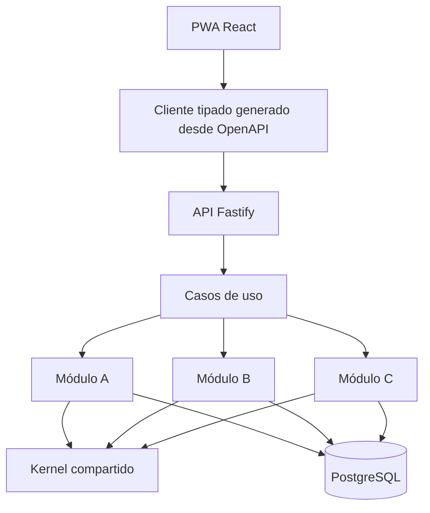

## TL;DR

Desarrollé una **PWA de trazabilidad** para una planta industrial que trabaja con metal: permite seguir la materia prima desde que entra hasta que sale como producto terminado, en pallets y con sus certificados de calidad. Reemplaza planillas en papel por registros desde **celulares y PC**.

Al ser un proyecto para un cliente, en este post no cuento nada del negocio: me enfoco en **cómo está construido** y en las decisiones de arquitectura que me gustaría repetir.

---

## El contexto: del papel al celular

En muchas plantas el seguimiento de la producción todavía se hace en papel. Eso trae problemas conocidos:

- la información llega tarde y a veces incompleta;
- reconstruir el origen de un producto lleva horas;
- los certificados de calidad se arman a mano.

El objetivo era que cada persona registre lo que hace **desde el lugar donde trabaja**, con un celular, y que la trazabilidad completa salga sola.

---

## Arquitectura: un monolito modular con arquitectura hexagonal

En lugar de microservicios, elegí un **monolito modular**: una sola aplicación desplegable, pero dividida internamente en módulos con fronteras estrictas.

Cada módulo tiene su **dominio**, sus **puertos** (interfaces) y sus **adaptadores** (por ejemplo, la implementación en PostgreSQL). Los casos de uso de la API coordinan módulos sin que estos se conozcan entre sí.

### Por qué no microservicios

- Un equipo chico no necesita la complejidad operativa de muchos servicios.
- Las transacciones entre módulos son simples dentro de una misma base.
- Si algún módulo algún día necesita escalar aparte, las fronteras ya están dibujadas.

> [!tip] Fronteras que no dependen de la buena voluntad
> Las reglas de dependencia entre capas se verifican automáticamente con **dependency-cruiser** en cada build. Si alguien importa algo que no debe, el CI falla.

---

## Decisiones técnicas que me gustaron

### Un kernel compartido y explícito

Lo transversal vive en un paquete `kernel`:

- **IDs UUID v7**, ordenables por tiempo;
- un **reloj** inyectable, así los tests controlan la fecha;
- **decimales exactos**, porque en pesos y medidas los errores de punto flotante no son aceptables;
- errores tipados y una **unidad de trabajo** para las transacciones.

### Contratos primero

La API se describe con **TypeBox** y genera un contrato **OpenAPI 3.1** versionado. A partir de ese contrato se genera un **cliente tipado** para la web. Si cambia la API y la web no se actualiza, no compila.

### Lectura de documentos en un proceso aislado

Parte de la información entra en documentos PDF. El lector que los procesa corre en un **proceso separado**: si un archivo viene malformado, no tumba la API.

### Una PWA pensada para la planta

La web es una **PWA instalable**, con vistas distintas según el rol (depósito, operario, administración). Usa **TanStack Router y Query** y componentes de **shadcn/ui**, con interfaces grandes y claras para usar con guantes y poca luz.

### Seguridad y operación

- contraseñas con **Argon2**, rate limiting y headers de seguridad;
- el primer administrador se crea con un procedimiento de **un solo uso**;
- despliegue con **Docker Compose** detrás de **Caddy** con HTTPS automático;
- scripts de backup y roles de base de datos separados.

---

## Calidad

- TypeScript estricto, lint y formato con **Biome**.
- **Vitest** para pruebas de dominio, de contrato y de integración contra un PostgreSQL real.
- **Playwright** para recorridos de punta a punta sobre la web compilada.
- **Changesets** para mantener el changelog.

---

## Stack

| Capa | Tecnología |
| --- | --- |
| Web | React 19, Vite, TanStack Router y Query, Tailwind, shadcn/ui, PWA |
| API | Node.js 24, Fastify 5, TypeBox, OpenAPI 3.1 |
| Datos | PostgreSQL y Drizzle ORM |
| Operación | Docker Compose, Caddy, GitHub Actions |
| Calidad | Biome, dependency-cruiser, Vitest, Playwright |

---

## Lo que aprendí

- **Un monolito bien modularizado** da casi todos los beneficios de los microservicios con una fracción de la complejidad.
- **Automatizar las reglas de arquitectura** es la única forma de que sobrevivan al paso del tiempo.
- **En la industria, la UX es física:** pantallas que se usan paradas, con apuro y a veces con guantes.
- **Los contratos tipados** entre API y web evitan una categoría entera de bugs.
