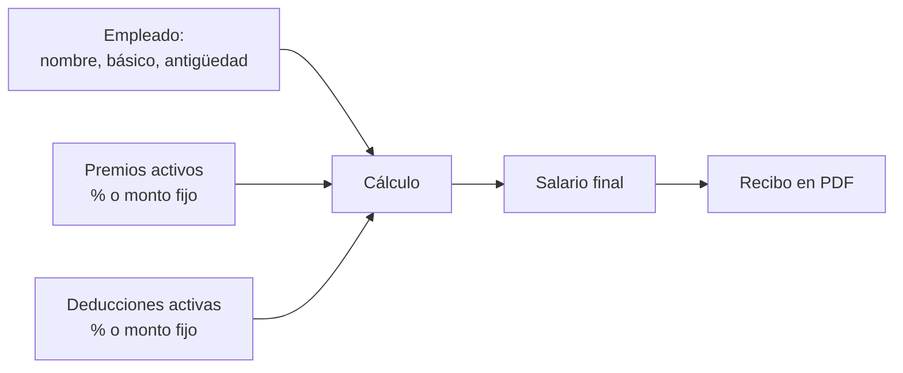

## TL;DR

**[Recibo Fácil](https://github.com/NicoTomasin/ReciboFacil)** es un generador de recibos de sueldo que funciona **completamente en el navegador**: cargás empleados, definís premios y deducciones y obtenés el salario final listo para imprimir en PDF. No hay backend, así que **ningún dato sale de tu computadora**.

Además, fue el proyecto que usé para aprender **Svelte** y su manejo de estado con *stores*. Es open source con licencia MIT.

---

## El problema

Para un negocio chico, hacer los recibos de sueldo suele ser una planilla de cálculo que alguien armó hace años y nadie se anima a tocar. Quería algo:

- **simple:** cargar un empleado y ver el resultado al instante;
- **privado:** sueldos y datos personales no deberían viajar a ningún servidor;
- **configurable:** cada negocio tiene sus propios adicionales y descuentos.

---

## Cómo funciona

1. Cargás un **empleado** con su sueldo básico y su antigüedad.
2. Definís **modificadores**: premios y deducciones, cada uno **porcentual** o de **monto fijo**, y los activás o desactivás.
3. La app recalcula el salario final automáticamente.
4. Generás el **recibo en PDF** listo para imprimir.

Viene con algunos modificadores de ejemplo precargados (un adicional por antigüedad y los aportes habituales), que se pueden editar o desactivar.

> [!note] Aclaración
> Es una herramienta de ayuda. No reemplaza el asesoramiento contable: los porcentajes dependen de cada convenio.

---

## Lo que aprendí de Svelte

El objetivo secundario del proyecto era entender cómo maneja el estado Svelte. Algunas cosas que me gustaron:

- **Stores escribibles:** los premios, las deducciones y la vista activa viven en stores. Cualquier componente se suscribe y se actualiza solo cuando cambian.
- **Reactividad sin ceremonias:** declarar variables reactivas es casi escribir JavaScript normal.
- **Componentes chicos:** el formulario de empleados, el de modificadores y los badges están separados y se comunican solo a través de los stores.
- **Un "router" mínimo:** como la app tiene dos vistas, en lugar de sumar una librería de ruteo uso un store que indica qué componente mostrar.

---

## Stack

| Parte | Tecnología |
| --- | --- |
| Framework | Svelte 4 con TypeScript |
| Build | Vite |
| Estilos | Tailwind CSS |
| PDF | pdfmake |
| Notificaciones | sonner |

---

## Roadmap

Lo que queda pendiente, y es una buena oportunidad si querés contribuir:

- validaciones en los formularios;
- guardar los datos en `localStorage`;
- exportar un CSV con todos los empleados;
- exportar e importar la configuración en un archivo JSON.

---

## Lo que aprendí

- **Aprender una tecnología con un problema real** es mucho más efectivo que seguir un tutorial.
- **No tener backend también es una feature:** para datos sensibles, que todo quede en el navegador es una ventaja.
- **Las dependencias envejecen:** un proyecto chico también necesita mantenimiento para seguir funcionando con las versiones nuevas de sus librerías.

El código está en [GitHub](https://github.com/NicoTomasin/ReciboFacil).
