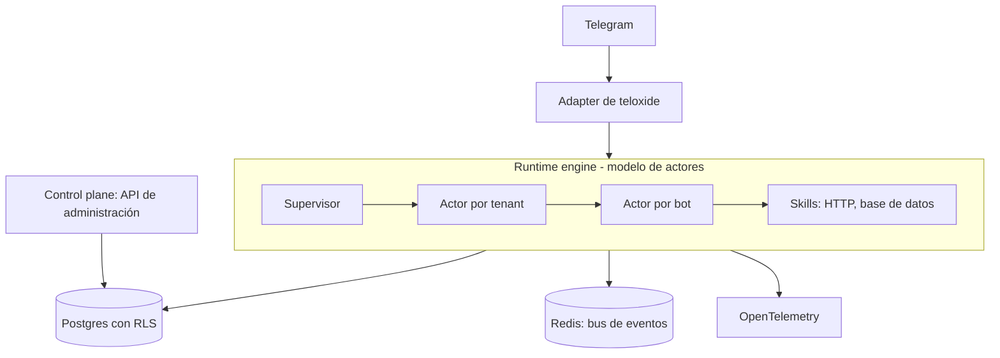

## TL;DR

Después de escribir varios bots de Telegram en Rust me di cuenta de que siempre repetía lo mismo: conexión con Telegram, manejo de estado, base de datos, logs. **Runtime Bots** es mi intento de convertir eso en una **plataforma**: un runtime donde muchos bots, de muchos clientes, corren aislados entre sí y se administran desde un panel central.

Es un proyecto en etapa de **arquitectura y prototipo**, y en este post cuento las decisiones de diseño.

---

## El problema: cada bot nuevo empieza de cero

Cada bot que hacía tenía la misma estructura:

- un loop que escucha mensajes de Telegram;
- lógica de conversación;
- acceso a una base de datos o a una API externa;
- logs para entender qué pasó cuando algo falla.

Multiplicá eso por varios bots y varios clientes, y mantenerlo se vuelve un problema. La idea: que crear un bot sea **configurar un flujo**, no escribir un servicio nuevo.

---

## Arquitectura

El proyecto es un workspace de Cargo con tres piezas:

- **teloxide-adapter:** traduce el mundo de Telegram al formato interno del runtime.
- **runtime-engine:** donde viven y se ejecutan los bots.
- **control-plane:** la API de administración para crear tenants, bots y configurarlos.

---

## Decisiones de diseño

### 1. Modelo de actores con Actix

Cada bot es un **actor**: una unidad aislada con su propio estado, que se comunica por mensajes. Los actores se organizan en un árbol:

- un **supervisor** del sistema;
- un actor por **tenant** (cliente);
- un actor por **bot**.

La ventaja es el aislamiento: si un bot falla, su supervisor lo reinicia sin afectar a los demás. Es el mismo principio que hizo famosos a Erlang y Akka.

### 2. Skills reutilizables

Lo que un bot puede hacer (llamar a una API HTTP, consultar una base) se modela como **skills** intercambiables. El flujo de cada bot se guarda como configuración, y el runtime arma el comportamiento combinando skills.

### 3. Aislamiento de datos con Row-Level Security

En lugar de confiar en que cada query filtre por cliente, la base de datos **lo garantiza**: Postgres tiene Row-Level Security activado, y cada consulta solo ve las filas del tenant en contexto. Un bug en el código no puede mezclar datos de dos clientes.

> [!tip] Defensa en profundidad
> El aislamiento multi-tenant no debería depender de acordarte de un `WHERE`. Que lo haga cumplir la base es una red de seguridad que vale la pena.

### 4. Secretos fuera de la base y auditoría append-only

Los tokens de Telegram no se guardan en texto plano: la tabla solo referencia un identificador en un servicio de manejo de claves. Además hay una tabla de **auditoría append-only** para saber quién hizo qué.

### 5. Observabilidad desde el inicio

El runtime emite trazas con **OpenTelemetry**. Cuando tenés decenas de bots corriendo, poder seguir un mensaje de punta a punta no es un lujo.

### 6. Operación documentada

El repo incluye **runbooks** para administración e incidentes: deploy con Docker Compose, escalado de workers, backups y rotación de claves. Escribirlos antes de tener usuarios me obligó a pensar cómo se opera el sistema, no solo cómo se programa.

---

## Stack

| Parte | Tecnología |
| --- | --- |
| Runtime | Rust, Actix (actores) y Tokio |
| Telegram | teloxide |
| Control plane | Axum, JWT y validator |
| Datos | Postgres con Row-Level Security |
| Eventos | Redis |
| Observabilidad | OpenTelemetry y tracing |
| Infra | Docker Compose, CI en GitHub Actions y test de carga con k6 |

---

## Lo que aprendí

- **Generalizar demasiado pronto es tentador.** Recién después de hacer varios bots a mano tuve claro qué partes valía la pena abstraer.
- **Los actores encajan perfecto con los bots:** cada conversación es naturalmente un proceso aislado con estado.
- **La seguridad multi-tenant se diseña en la base de datos,** no solo en el código.

El proyecto sigue en etapa de prototipo. Muchas de estas ideas ya las aplico en bots más chicos, como el de mantenimiento del auto o el de ahorro en BTC.
