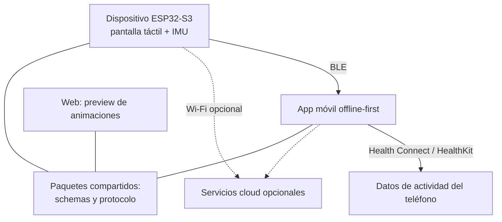

## TL;DR

Este proyecto es un **tamagotchi de escritorio**: un pequeño dispositivo con pantalla táctil que tiene personalidad propia y se pone **inquieto, molesto o muy molesto** cuando pasás demasiado tiempo sin moverte. Funciona solo, sin teléfono, pero si lo conectás a la app, usa los datos de actividad de tu celular para ser más preciso.

Es mi primer proyecto serio de **hardware + firmware**, y lo encaré con el mismo rigor que un sistema distribuido: decisiones documentadas, protocolos versionados y recuperación ante cortes como requisito, no como extra.

---

## La idea

Las apps que te avisan "levantate" se ignoran fácil: son una notificación más. Un objeto físico en tu escritorio, con una carita que se va enojando, es mucho más difícil de ignorar. Y si además tiene **personalidad persistente**, se transforma en algo con lo que tenés una relación, no en una alarma.

Algunos principios que definí desde el arranque:

- **No es un dispositivo médico** y no hace diagnósticos.
- **Funciona offline**: el dispositivo arranca y calcula solo, sin depender de BLE, Wi-Fi ni la nube.
- **Honestidad con los datos**: el movimiento del dispositivo es solo evidencia indirecta; nunca se presenta como "caminaste". Si falta información, queda como desconocida.
- **Privacidad granular**: la cuenta en la nube es opcional, y los datos de salud requieren consentimiento explícito, exportación y borrado verificable.
- **La expresión se puede silenciar** sin afectar el cálculo ni el historial.

---

## Arquitectura general

El repo es un monorepo con:

- `firmware/`: proyecto **ESP-IDF** para el ESP32-S3 (Waveshare con pantalla táctil de 1.83").
- `apps/mobile/`: app móvil offline-first.
- `apps/web/`: preview web de animaciones y assets.
- `backend/`: servicios cloud opcionales.
- `packages/`: schemas del protocolo y de las animaciones, compartidos por todos.
- `tools/`: validadores y simuladores.

---

## Decisiones técnicas (documentadas como ADRs)

Cada decisión importante quedó escrita como un **ADR** (Architecture Decision Record): qué se decidió, por qué y qué consecuencias tiene. Estas son las que más me enseñaron.

### 1. Un protocolo BLE propio, compacto y reanudable

Los mensajes viajan como frames **CBOR** dentro de un servicio GATT propio, con versión, ID de mensaje, offset, CRC y confirmaciones acumulativas. Así una transferencia larga puede cortarse y **reanudarse donde quedó**. El transporte no sabe nada de la lógica del producto: solo mueve bytes de forma confiable.

### 2. Un journal append-only como fuente de verdad

Todo lo que pasa se guarda como eventos inmutables, con checksum por registro y deduplicación por ID. El estado que se ve en pantalla es una **proyección** que se puede reconstruir desde el journal. Resultado: si se corta la luz, el dispositivo vuelve exactamente al mismo estado, de forma determinista.

### 3. Animaciones como datos, no como código

La personalidad visual se distribuye en **paquetes de animación** declarativos (manifiesto + spritesheet) que se validan antes de usarse, se instalan de forma atómica y no contienen código ejecutable. Los mismos paquetes se ven en el firmware y en la preview web.

### 4. Actualizaciones OTA que no te dejan un ladrillo

Las actualizaciones por aire usan **dos particiones (A/B)**, firma, confirmación de que el nuevo firmware arrancó sano y **rollback automático** si no. Firmware y assets se actualizan por separado.

### 5. App móvil con UI compartida y adapters nativos

**Flutter** para la interfaz, con plugins nativos en Kotlin y Swift para lo que exige el sistema operativo: BLE, Health Connect, HealthKit, ejecución en segundo plano y almacenamiento seguro.

> [!tip] Lo que más me sirvió
> Tratar un gadget de escritorio como un sistema distribuido. Protocolos versionados, eventos inmutables y recuperación ante fallas hacen que el hardware deje de ser "frágil".

---

## Cómo lo trabajo

- **Desarrollo por fases**, con evidencia documentada al cerrar cada una.
- **Modelo de amenazas**, inventario de datos y matriz de riesgos escritos antes de tocar la nube.
- **Matrices de hardware y plataformas móviles** para saber qué se probó dónde.
- **Tests con Node** para los schemas y el protocolo, corriendo en CI.
- El objetivo es tener **tres unidades** para pruebas en paralelo antes de las pruebas con hardware en el loop.

---

## Stack

| Parte | Tecnología |
| --- | --- |
| Hardware | Waveshare ESP32-S3 con pantalla táctil 1.83" e IMU |
| Firmware | C con ESP-IDF 5.5 |
| Comunicación | BLE GATT con frames CBOR; Wi-Fi opcional |
| App móvil | Flutter + plugins nativos Kotlin/Swift |
| Compartido | JSON Schema para protocolo y animaciones |
| Calidad | Node test runner y GitHub Actions |

---

## Lo que aprendí

- **En hardware, el estado es sagrado.** Diseñar para cortes de energía desde el principio cambia toda la arquitectura.
- **Los ADRs valen oro** cuando un proyecto tiene muchas piezas y se trabaja por etapas: cualquier decisión se puede retomar sabiendo por qué se tomó.
- **Separar transporte de lógica** hace que el protocolo sea testeable y reutilizable.
- **Ser honesto con los datos** también es diseño de producto.

El proyecto sigue en desarrollo. Cuando tenga las primeras unidades funcionando, prometo un post con fotos del bicho en acción.
