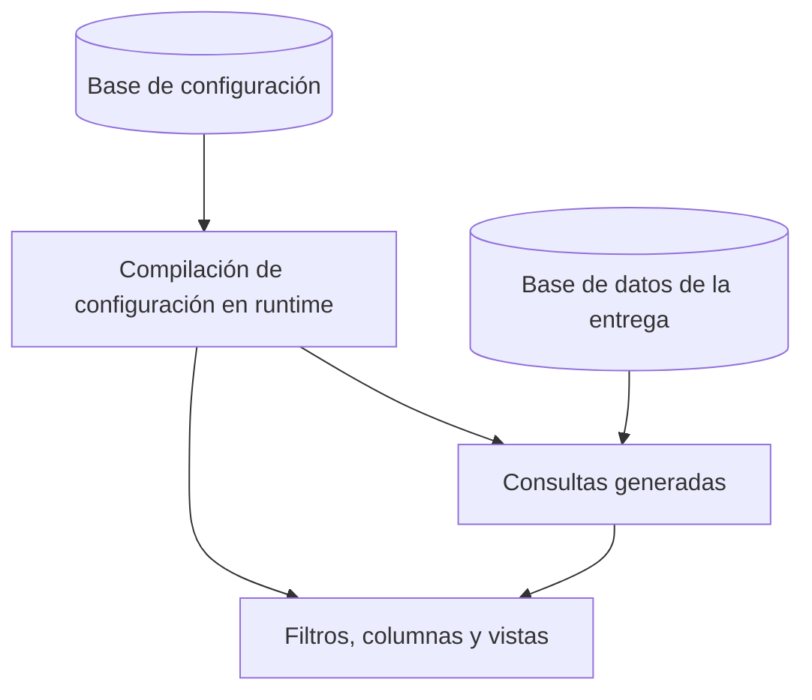

## TL;DR

En **G2M Technology Group** construimos un **visualizador web** para consultar, filtrar y revisar grandes volúmenes de registros y sus imágenes digitalizadas. La particularidad: se despliega contra **bases de datos que no controlamos** y que cambian de estructura de una entrega a otra. La solución fue que el código conozca **el mecanismo** y que la configuración conozca **el dominio**.

> [!note] Sobre este post
> Es un producto de mi trabajo actual. Cuento el enfoque de diseño y el stack; no incluye datos, estructuras de clientes ni reglas de negocio.

---

## El problema: el esquema cambia en cada entrega

Las bases con las que trabaja el visualizador:

- cambian de estructura entre entregas y clientes;
- tienen convenciones, pero no garantías;
- **no las gobierna la aplicación.**

Si los nombres de columnas, los filtros o las rutas estuvieran escritos en el código, cada entrega nueva implicaría tocar código, testear y volver a desplegar.

---

## La idea central: el código conoce el mecanismo, la configuración conoce el dominio

Todo lo que la app necesita saber de una entrega vive como **datos** en una base de configuración propia: qué tablas mirar, qué columnas mostrar, qué filtros ofrecer y cómo agruparlos. Al arrancar, el sistema **compila esa configuración** y arma consultas, filtros y vistas.

Resultado: una entrega nueva se resuelve **configurando**, no programando.

> [!tip] La regla que nos guía
> Si algo cambia entre clientes, es configuración. Si es igual para todos, es código.

---

## Otras piezas interesantes

### Dashboards armables

Los paneles se componen con widgets que el usuario puede **mover y redimensionar** (con GridStack), gráficos con **ECharts** y visores de imagen con zoom y paneo.

### Permisos y roles

Un sistema de **roles y permisos** controla quién puede ver, revisar o editar, incluida la **edición masiva** por lotes, que tiene sus propios permisos y tests.

### Un "modo lector" generado desde el mismo código

Algunos usuarios solo necesitan consultar. En lugar de mantener una segunda aplicación, generamos un **build de solo lectura** a partir del mismo código:

- usa las mismas páginas del producto;
- una constante de build indica el modo, y todo lo de edición y administración **se elimina del paquete** final;
- los permisos son fijos de lectura y el login no escribe en la base.

Así hay **un solo código para mantener** y dos artefactos con superficies de ataque muy distintas.

### Migraciones versionadas

La base de configuración tiene **migraciones numeradas**, así cada instalación sabe exactamente en qué versión está.

---

## Stack

| Parte | Tecnología |
| --- | --- |
| Runtime | Bun |
| Framework | Astro en modo servidor |
| Datos | MySQL con `mysql2` |
| Visualización | ECharts, GridStack, Panzoom y SortableJS |
| Seguridad | Roles y permisos propios, contraseñas con bcrypt |

---

## Lo que aprendí

- **No pelees contra datos que no controlás:** diseñá para que cambien.
- **Mover el dominio a configuración** tiene un costo inicial alto, pero cada entrega siguiente es mucho más barata.
- **Generar variantes desde un mismo código** (con constantes de build) es mejor que mantener dos productos casi iguales.
